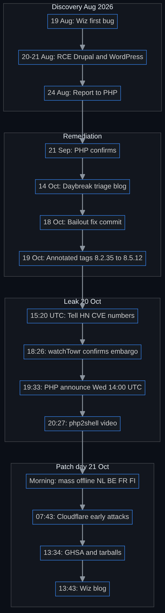
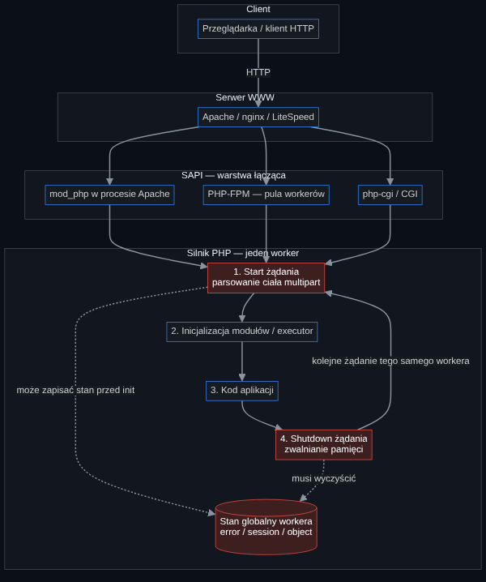
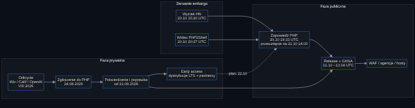
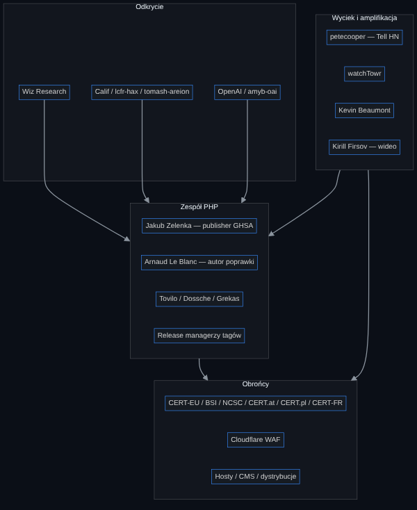

# PHP2Shell — the case study

**A deep case study of the critical core-PHP vulnerabilities CVE-2026-109618 and CVE-2026-109619**

- **Document version:** 1.2, subsection 7.4 as of 22 Oct 2026, 12:30 UTC (English adaptation of the Polish master)
- **As of:** 21 Oct 2026, 14:05 UTC (16:05 CEST) — about 30 minutes after the patches went public
- **Nature:** Defensive, historical analysis — **no** exploit code, payloads, PoCs, or attack instructions
- **Labels:** **[P]** primary source · **[D]** third-party report · **[?]** open / conflicting · **[A]** this document’s analysis
- **Evidence ledger:** each significant claim has an ID (CLM-…) tracked in [`case-study/evidence-ledger.jsonl`](https://github.com/Akirapl/php2shell/blob/main/case-study/evidence-ledger.jsonl) (also [CSV](https://github.com/Akirapl/php2shell/blob/main/case-study/evidence-ledger.csv)) with the primary source, the exact place in it, publication and event time, verification status and contrary evidence
- **Time zones:** UTC; Warsaw time in parentheses. 20–21 Oct 2026: **CEST = UTC+2**

> **Editorial note.** Written on patch day. Distro packages, confirmed exploitation, and full discoverer write-ups are still settling. Every claim is footnoted; section 12 and the changelog say what would revise this picture.

## Changelog

- **1.1** (2026-10-22 10:30 UTC) — New subsection 7.4: exploitation picture since disclosure (AWS MadPot 17 Oct, Cloudflare, VulnCheck, watchTowr, Recorded Future), precautionary takedowns in Germany and Denmark, exposure estimates (Censys, Unit 42), backports for EOL branches; Appendix A entries; ledger CLM-0090…CLM-0101. The rest of the document is unchanged (as of 21 Oct).
- **1.2** (2026-10-22 12:30 UTC) — §7.4: CrowdStrike finding (verified RCE on Apache `mod_php`, configuration condition, log trace); conclusion extended; ledger CLM-0102.
- **1.0.1** (2026-10-21 17:30 UTC) — Evidence ledger (CLM-0001…) added. Corrections from the ledger check: fix commit touches 423 files, not 300 (GitHub’s commit API lists only the first 300); PHP Foundation’s original release time (22 Oct 14:00 UTC) added as a third, conflicting embargo time; sources added for watchTowr Active Defense, Sansec’s “15 minutes” (SecurityWeek), the Remi warning (PHP Foundation on X), NU.nl/BBC offline lists and Patchstack/Firsov; BSI quote made precise; Huntress date corrected; Log4Shell probes were 8 days (not 9) before disclosure per Cloudflare; an unsourced Aikido “since June 2026” remark and an unverifiable Hadrian “at scale” claim removed/softened.
- **1.0** (2026-10-21 14:05 UTC) — First release. Sources: php.net, GHSA, the fix commit, Wiz, watchTowr, BSI, NCSC UK, NCSC-NL, CERT-EU, CERT.at, CERT Polska, CERT-FR, NOS, W3Techs, Modat, heise, SecurityWeek, Huntress, Tenable, Cloudflare, Docker PR, Ubuntu tracker, HN, Mastodon; historical comparisons (Log4Shell, Heartbleed, CVE-2024-4577, OpenSSL 3.0.7).

## Contents

0. [TL;DR and one-page overview](#0-tldr-and-one-page-overview)
1. [Background: PHP and the request lifecycle](#1-background-php-on-the-web-and-the-request-lifecycle)
2. [The vulnerabilities, in depth](#2-the-vulnerabilities-in-depth)
3. [Discovery and AI-assisted research](#3-discovery-wiz-calif-openai-and-ai-assisted-research)
4. [Coordinated disclosure](#4-coordinated-disclosure-101-and-how-it-went-here)
5. [The leak and the name PHP2Shell](#5-the-leak-and-the-name-php2shell)
6. [Patch day](#6-patch-day)
7. [The exploit race](#7-the-exploit-race)
8. [Defenders’ response](#8-defenders-response)
9. [Exposure and impact](#9-exposure-and-impact)
10. [Historical comparison](#10-historical-comparison)
11. [Lessons learned](#11-lessons-learned)
12. [Open questions](#12-open-questions)
- [Appendix A: Full timeline](#appendix-a-full-timeline)
- [Appendix B: Glossary](#appendix-b-glossary)
- [Appendix C: Defensive checklist](#appendix-c-defensive-checklist)
- [Appendix D: Sources](#appendix-d-sources)

---

## 0. TL;DR and one-page overview

**In one paragraph.** Around **13:34 UTC** on 21 October 2026, the PHP security team published **8.5.12, 8.4.27, 8.3.36 and 8.2.35** and two GitHub advisories for critical engine bugs: **CVE-2026-109618** (“RCE via OOM corruption”) and **CVE-2026-109619** (“RCE via stale global state”), both **CVSS v4.0 9.2** [P][^ghsa618][^ghsa619][^phpadv]. Both stem from the same pattern: when PHP aborts a request under emergency conditions (especially out-of-memory), it can leave internal state pointing at memory that no longer exists — and a later step or a later request on the same worker can use that “ghost”. On **Apache + mod_php**, unauthenticated remote code execution was demonstrated **before any application code runs** [P][^phpadv]. Wiz Research claims discovery with Calif and OpenAI, using frontier AI models heavily [D][^wiz]. A Thursday 22 Oct embargo broke with a 20 Oct leak, forcing PHP to pre-announce and pull the release forward by a day [P][^wtx][^phppre]. In the Netherlands, Belgium, France and Finland, some sites went offline as a precaution [P][^nos]. As of this version’s cutoff there is no independently confirmed in-the-wild exploitation; reports conflict [?].

> ### Key facts
>
> - **IDs:** CVE-2026-109618 (GHSA-w8hw-w9fx-j79w), CVE-2026-109619 (GHSA-6wmf-4rv5-p3rp) [P]
> - **CVSS v4.0:** 9.2 · `AV:N/AC:H/AT:P/PR:N/UI:N/VC:H/VI:H/VA:H/SC:N/SI:N/SA:N` (both) [P]
> - **CWE:** 416, 755, 824, 1325, 1419 [P]
> - **Impact:** unauth RCE as the web worker; 619 also memory disclosure [P]
> - **Worst SAPI:** Apache mod_php (before application code) [P]
> - **Fixed:** 8.5.12, 8.4.27, 8.3.36, 8.2.35; minimal source backports for 7.4/8.0/8.1 [P]
> - **Publication:** GHSA 13:34 UTC; 8.5.12 tarball `Last-Modified` 13:33:59 GMT [P]
> - **Original embargo:** 22 Oct 2026 11:00 ET (15:00 UTC = 17:00 CEST; the HN leak named 18:00 CEST, see 5.1) [P]; the PHP Foundation later gave the originally planned release as 22 Oct **14:00 UTC** — the accounts conflict [?][^phpfback]
> - **GHSA credits:** sagitzadik-wiz, tomash-areion, lcfr-hax, amyb-oai [P]
> - **Fix:** Arnaud Le Blanc (+ Tovilo, Zelenka, Dossche, Grekas); +11,556/−1,017 across 423 files [P]
> - **PHP share:** 69.3% of sites with a known server-side language (W3Techs 21 Oct) [P]
> - **Exposure:** 4.38M PHP services / 1.89M hosts; ~79% EOL (Modat 20 Oct) [D]
> - **Complete fix:** update only [P]
>
> *Ledger: key facts = CLM-0001…CLM-0014; exploitation status = CLM-0054…CLM-0065.*

**What is new here** [A]: (1) a bug in the *runtime*, not the app; (2) AI in discovery and — researchers say — in making exploitation practical; (3) an embargo leak that became a ~22-hour race; (4) precautionary public-site takedowns in several EU countries before a patch existed.

<figure class="diagram" id="dg-timeline">

<figcaption>Timeline</figcaption>

Text description of the diagram

PHP2Shell timeline: 15 events in one chronological chain, split into four phases — discovery (August 2026), remediation, leak (20 October) and patch day (21 October).

Flow diagram (top to bottom): 15 events linked by arrows into one chain; the last event of each phase leads to the first event of the next. The diagram labels are in English.

<ul>
<li><b>Discovery (August 2026):</b> 19 Aug — Wiz finds the first bug → 20–21 Aug — RCE on Drupal and WordPress → 24 Aug — report to PHP.</li>
<li><b>Remediation:</b> 21 Sep — PHP confirms → 14 Oct — Daybreak triage blog post → 18 Oct — bailout fix commit → 19 Oct — annotated tags 8.2.35 to 8.5.12.</li>
<li><b>Leak (20 Oct):</b> 15:20 UTC — “Tell HN” post with the CVE numbers → 18:26 — watchTowr confirms the embargo → 19:33 — PHP announces a release for Wednesday 14:00 UTC → 20:27 — php2shell video.</li>
<li><b>Patch day (21 Oct):</b> morning — mass offline in NL, BE, FR, FI → 07:43 — Cloudflare: early attacks → 13:34 — GHSA and tarballs → 13:43 — Wiz blog post.</li>
</ul>

Mermaid source
<pre><code class="language-mermaid">flowchart TB
  subgraph D[Discovery Aug 2026]
    d1[19 Aug: Wiz first bug]
    d2[20-21 Aug: RCE Drupal and WordPress]
    d3[24 Aug: Report to PHP]
  end
  subgraph R[Remediation]
    r1[21 Sep: PHP confirms]
    r2[14 Oct: Daybreak triage blog]
    r3[18 Oct: Bailout fix commit]
    r4[19 Oct: Annotated tags 8.2.35 to 8.5.12]
  end
  subgraph L[Leak 20 Oct]
    l1[15:20 UTC: Tell HN CVE numbers]
    l2[18:26: watchTowr confirms embargo]
    l3[19:33: PHP announce Wed 14:00 UTC]
    l4[20:27: php2shell video]
  end
  subgraph P[Patch day 21 Oct]
    p1[Morning: mass offline NL BE FR FI]
    p2[07:43: Cloudflare early attacks]
    p3[13:34: GHSA and tarballs]
    p4[13:43: Wiz blog]
  end
  d1 --&gt; d2 --&gt; d3 --&gt; r1 --&gt; r2 --&gt; r3 --&gt; r4 --&gt; l1 --&gt; l2 --&gt; l3 --&gt; l4 --&gt; p1 --&gt; p2 --&gt; p3 --&gt; p4</code></pre>

</figure>

---

## 1. Background: PHP on the web and the request lifecycle

### 1.1 How large PHP is

Rasmus Lerdorf created PHP in 1994 (as “Personal Home Page Tools”) and released its source code to the public in June 1995 [P][^phphist]. Per W3Techs (21 Oct 2026), PHP is used by **69.3%** of websites whose server-side language is known; among PHP sites, **65.2%** run version 8, **27.0%** version 7, **7.7%** version 5, **0.1%** version 4 [P][^w3t]. WordPress, Drupal, Joomla, Magento and MediaWiki all run on PHP [D][^wiz].

**Method note** [A]: “69.3%” is of sites *with a recognized* server-side language, not “the whole Internet”. Headlines like “70% of the Internet” (Wiz) are simplifications [D][^wiz].

### 1.2 What happens when a browser asks for a page

PHP is usually embedded in a web server or run as a pool of workers. The glue is called a **SAPI** (Server API).

- **Apache mod_php**
  - *How it works:* PHP inside Apache processes (typically prefork: many processes, each handling requests in sequence).
  - *Why it matters for PHP2Shell:* Worst case: request shutdown always runs, even when startup failed [P][^ghsa618].
- **PHP-FPM**
  - *How it works:* Separate PHP pool; nginx/Apache via FastCGI.
  - *Why it matters for PHP2Shell:* On failed startup FPM kills the child — breaks the simplest path; others remain [P][^ghsa618][^ghsa619].
- **CGI / php-cgi**
  - *How it works:* Classically one process per request (or FastCGI).
  - *Why it matters for PHP2Shell:* Listed as affected [P][^phpadv].
- **FrankenPHP**
  - *How it works:* Modern PHP application server.
  - *Why it matters for PHP2Shell:* Source analysis: likely mod_php-like on shutdown [P][^ghsa618].
- **LiteSpeed LSAPI**
  - *How it works:* FPM-like model.
  - *Why it matters for PHP2Shell:* App-specific paths “likely, unvalidated” [P][^ghsa618].

**Analogy** [A]: a PHP worker is a clerk’s desk. Each request is a case file. After the case, every folder must be put away. If the lights go out in a panic (OOM / fatal), a sticky note with a folder address may remain for a folder that was already shredded. The next visitor — same desk — treats that address as live. That is “stale global state” and “OOM corruption”.

<figure class="diagram" id="dg-lifecycle">

<figcaption>Request lifecycle</figcaption>

Text description of the diagram

PHP HTTP request lifecycle: client → web server → one of three SAPIs → four stages inside one PHP worker, with the shared worker-global state marked as the risk.

Block diagram (top to bottom) in four layers: client, web server, SAPI (the connecting layer) and PHP engine (one worker). The diagram labels are in Polish.

<ul>
<li><b>Client → web server:</b> a browser / HTTP client sends an HTTP request to the web server (Apache / nginx / LiteSpeed).</li>
<li><b>Web server → SAPI:</b> the server hands the request to one of three SAPIs: mod_php inside the Apache process, PHP-FPM (worker pool) or php-cgi / CGI.</li>
<li><b>SAPI → engine:</b> each of the three SAPIs leads to stage 1 in the PHP engine.</li>
<li><b>Stages inside the worker, in order:</b> 1. request startup (multipart body parsing) → 2. module / executor initialisation → 3. application code → 4. request shutdown (memory release).</li>
<li><b>Worker-global state</b> (error / session / object): a dashed line from stage 1 labelled “may write state before init” and a dashed line from stage 4 labelled “must clean up”.</li>
<li><b>Loop:</b> an arrow from stage 4 returns to stage 1 — “next request of the same worker”.</li>
<li><b>Highlighted in red (risk):</b> request startup, worker-global state and request shutdown.</li>
</ul>

Mermaid source
<pre><code class="language-mermaid">flowchart TB
  subgraph Client
    B[Przeglądarka / klient HTTP]
  end
  subgraph WebServer[Serwer WWW]
    WS[Apache / nginx / LiteSpeed]
  end
  subgraph SAPI[SAPI — warstwa łącząca]
    MP[mod_php w procesie Apache]
    FPM[PHP-FPM — pula workerów]
    CGI[php-cgi / CGI]
  end
  subgraph Engine[Silnik PHP — jeden worker]
    ST[1. Start żądania&lt;br/&gt;parsowanie ciała multipart]
    IN[2. Inicjalizacja modułów / executor]
    APP[3. Kod aplikacji]
    SH[4. Shutdown żądania&lt;br/&gt;zwalnianie pamięci]
    GL[(Stan globalny workera&lt;br/&gt;error / session / object)]
  end
  B --&gt;|HTTP| WS
  WS --&gt; MP
  WS --&gt; FPM
  WS --&gt; CGI
  MP --&gt; ST
  FPM --&gt; ST
  CGI --&gt; ST
  ST --&gt; IN --&gt; APP --&gt; SH
  ST -.-&gt;|może zapisać stan przed init| GL
  SH -.-&gt;|musi wyczyścić| GL
  SH --&gt;|kolejne żądanie tego samego workera| ST
  classDef risk fill:#3d1f1f,stroke:#f85149,color:#fff
  class ST,GL,SH risk</code></pre>

</figure>

### 1.3 Why this matters

Most critical PHP-ecosystem bugs live in *applications*. Here the bug is in the **engine** [P][^phpadv]. A “Hello World” app on an affected version is still exposed [D][^wiz]. Inventory must cover CMSes, control panels, appliances with PHP in firmware, and hidden `php.exe` binaries [D][^huntress][^heise].

---

## 2. The vulnerabilities, in depth

### 2.1 Shared pattern

Official advisories and the Wiz blog describe variants of the same cross-request memory-safety failure [P][^ghsa618][^ghsa619][^wiz]:

1. An operation stores request-owned state in a worker-global location (**producer**).
2. A fatal / OOM / diagnostic aborts before the matching reset.
3. Request memory is freed; the global still points at it.
4. The same worker handles another request.
5. An operation before normal initialization reads that pointer (**consumer**) → use-after-free → with a suitable heap layout: RCE.

**Why memory-safety bugs in a runtime are hard** [A]: they are not “one hole in function X” but an interaction of allocator, error handling (`longjmp` / bailout), many extensions and many SAPIs. The fix had to change OOM strategy and reset a wide set of globals (~400 files) [P][^commit].

### 2.2 CVE-2026-109618 — RCE via OOM corruption

**What was wrong.** PHP used `longjmp()` on OOM to leave the current context and abort the request. When request memory was only partly initialized, that early exit left invalid state; shutdown could treat it as valid [P][^ghsa618].

**OOM strategies** (concepts only) [P][^ghsa618]: multipart without a usable Content-Length; unbounded part headers (more memory than on the wire); empty file controls not counting toward `max_file_uploads` but still creating metadata. Application behavior can also reach OOM.

**Why mod_php is worst.** Apache mod_php **unconditionally** runs request shutdown even when startup failed. Body parsing during startup can exhaust `memory_limit` in the invalid-state window — **before the application runs** [P][^ghsa618][^phpadv]. FPM exits the child on failed startup; source analysis still treats FPM as susceptible, but no complete FPM exploit for 618 was demonstrated [P][^ghsa618].

**The fix.** Remove `longjmp()` for OOM → soft OOM at a VM safe point + hard OOM via `_exit()` at a second threshold [P][^ghsa618][^commit].

### 2.3 CVE-2026-109619 — RCE via stale global state

**What was wrong.** Worker-global state (error / session / object / extension) can point at request memory. A fatal, OOM or diagnostic leaves a stale pointer; a later request consumes it **before** normal initialization [P][^ghsa619].

**Confirmed consumers** [P][^ghsa619]:

- **INI diagnostics before init** — warnings/deprecations while applying settings (`.htaccess` / `php_value` on mod_php; `PHP_VALUE` on FPM) before the executor initializes. Hiding diagnostics does **not** help.
- **Session upload progress** — can reach session handling before ordinary initialization; independent of the INI path.

**Strongest demonstrated case:** `fatal_error_backtraces` (PHP 8.5) + a diagnostic → confirmed RCE on mod_php. Session upload-progress RCE: confirmed on mod_php **and** FPM [P][^ghsa619].

**Wiz’s four classes** (grouped under two CVEs) [D][^wiz]: upload-progress unserializer UAF; PHPSESSID memory disclosure; fatal-backtrace UAF; OPcache type confusion. Directionally aligned with the GHSA; chain detail is from Wiz.

### 2.4 CVSS v4.0 decoded

Both CVEs: `CVSS:4.0/AV:N/AC:H/AT:P/PR:N/UI:N/VC:H/VI:H/VA:H/SC:N/SI:N/SA:N` → **9.2** [P][^ghsa618][^ghsa619].

| Field | Value | Meaning |
|---|---|---|
| AV:N | Network | Remotely reachable |
| AC:H | High | High attack complexity (heap layout, conditions) |
| AT:P | Present | Preconditions in the system |
| PR:N | None | No authentication |
| UI:N | None | No user interaction |
| VC/VI/VA:H | High | Full impact on confidentiality, integrity, availability of the **vulnerable** system |
| SC/SI/SA:N | None | No scored impact on **subsequent** systems |

Early chatter said “CVSS 10.0” [D][^hnleak][^wtx] — PHP’s official score is 9.2 with AC:H and AT:P.

### 2.5 Versions: fixed, EOL, backports

| Branch | PHP support | Fix |
|---|---|---|
| 8.5 | supported | **8.5.12** |
| 8.4 | supported | **8.4.27** |
| 8.3 | supported | **8.3.36** |
| 8.2 | security until 31 Dec 2026 | **8.2.35** |
| 8.1 / 8.0 / 7.4 | EOL | minimal **source backports**; no official releases |
| ≤ 7.3 / 5.x | EOL | no official fix; LTS vendors may backport |

[P][^phpadv]. “Since 5.4” / “from PHP 5” comes from Wiz, CERT-EU, NCSC-NL and peers — not from the GHSA `vulnerable_version_range` tables (which list only fixed branches) [P/D][^ghsa618][^wiz][^certeu][^ncscnl].

### 2.6 Incomplete mitigations

PHP and core developers stress: **the only complete mitigation is updating** [P][^phpadv][^girgias]. Temporary measures (e.g. `memory_limit=-1`, `session.upload_progress.enabled=0`, on 8.5 `fatal_error_backtraces=0`) shrink specific paths; they do not make an install safe [P][^phpadv]. Do not use `RLIMIT_AS`/`RLIMIT_DATA` as substitutes — they can force the vulnerable `mmap`→`longjmp` path [P][^ghsa618].

---

## 3. Discovery: Wiz, Calif, OpenAI and AI-assisted research

### 3.1 Timeline per Wiz (third-party)

| Date | Event | Status |
|---|---|---|
| 19 Aug 2026 | First bug with Wiz Atlas, “Gemini 4 Argon”, “GPT-5.6 Sol” | [D][^wiz] |
| 20 Aug 2026 | Unauth RCE on Drupal | [D][^wiz] |
| 21 Aug 2026 | Unauth RCE on WordPress | [D][^wiz] |
| 24 Aug 2026 | Report to PHP | [D][^wiz] |
| 21 Sep 2026 | PHP acknowledges and starts a coordinated fix | [D][^wiz] |
| 21 Oct 2026 | Public patches + Wiz blog | [P][^wiz][^phpadv] |

GHSA credits: `sagitzadik-wiz`, `tomash-areion`, `lcfr-hax`, `amyb-oai` [P][^ghsa618]. Wiz thanks Calif and OpenAI; heise describes a Calif audit with the PHP Ecosystem Security Team under OpenAI’s “Patch the Planet” [D][^wiz][^heise]. Calif had earlier (1 May 2026) published separate research on a 21-year-old PHP UAF [P][^califmad].

### 3.2 What AI changes in bug hunting

Wiz: the vulnerable code had been present for more than a decade; building a working chain meant combining multiple bugs and adapting to memory layouts — frontier models “substantially reduced that barrier” [D][^wiz]. BSI expects large-scale exploitation “within a few hours” of the updates, because attackers can analyse them quickly with AI-assisted tools [P][^bsipresse].

**[A]** That does not mean “AI found the CVE alone”. It means the cost of going from a hard memory-safety bug to credible RCE across many targets fell. The same economics apply to attackers (patch reverse-engineering) and defenders (triage).

The PHP Foundation (14 Oct 2026) described using **Daybreak Red** (OpenAI) to validate reports and sort the queue — context for a surge of AI-assisted submissions [P][^phpfound].

### 3.3 The 2024 audit and the Ecosystem Security Team

In 2024 Quarkslab (Sovereign Tech Agency / OSTIF) found 17 security-relevant findings; heise notes a similar class of issue had already sparked remediation debate [P/D][^audit2024][^heise]. In May 2026 the PHP Foundation announced an Ecosystem Security Team [D][^heise]. PHP2Shell shows both investment in security and a long architectural tail around bailout/OOM [A].

---

## 4. Coordinated disclosure 101 and how it went here

### 4.1 Coordinated disclosure 101

Typical flow [A]: (1) private report; (2) confirm and fix; (3) embargoed notice to distros/LTS and selected partners; (4) simultaneous advisories + releases; (5) ecosystem messaging. Goal: shrink the window between attacker knowledge and patch availability.

### 4.2 How it went here

<figure class="diagram" id="dg-disclosure">

<figcaption>Disclosure flow</figcaption>

Text description of the diagram

Disclosure flow: private phase (discovery, report, fix, early access), embargo break (HN leak, video) and public phase (PHP announcement, release with GHSA, WAF / agencies / hosts).

Flow diagram (left to right) in three groups. The diagram labels are in Polish.

<ul>
<li><b>Private phase:</b> discovery (Wiz / Calif / OpenAI, Aug 2026) → report to PHP (24 Aug 2026) → confirmation and fix (from 21 Sep 2026) → early access (LTS distributions + partners).</li>
<li><b>Plan:</b> from early access, a dashed line labelled “plan: 22 Oct” leads to the PHP announcement.</li>
<li><b>Embargo break:</b> HN leak (20 Oct, 15:20 UTC) and PHP2Shell video (20 Oct, 20:27 UTC) — both lead to the PHP announcement.</li>
<li><b>Public phase:</b> PHP announcement (20 Oct, 19:33 UTC; moved to 21 Oct, 14:00) → release + GHSA (21 Oct, ~13:34 UTC) → WAF / agencies / hosts.</li>
<li><b>Shortcut:</b> confirmation and fix also lead directly to release + GHSA.</li>
</ul>

Mermaid source
<pre><code class="language-mermaid">flowchart LR
  subgraph Private[Faza prywatna]
    D[Odkrycie&lt;br/&gt;Wiz / Calif / OpenAI&lt;br/&gt;VIII 2026]
    R[Zgłoszenie do PHP&lt;br/&gt;24.08.2026]
    F[Potwierdzenie i poprawka&lt;br/&gt;od 21.09.2026]
    EA[Early access&lt;br/&gt;dystrybucje LTS + partnerzy]
  end
  subgraph Break[Zerwanie embarga]
    L[Wyciek HN&lt;br/&gt;20.10 15:20 UTC]
    V[Wideo PHP2Shell&lt;br/&gt;20.10 20:27 UTC]
  end
  subgraph Public[Faza publiczna]
    A[Zapowiedź PHP&lt;br/&gt;20.10 19:33 UTC&lt;br/&gt;przesunięcie na 21.10 14:00]
    P[Release + GHSA&lt;br/&gt;21.10 ~13:34 UTC]
    W[WAF / agencje / hosty]
  end
  D --&gt; R --&gt; F --&gt; EA
  EA -.-&gt;|plan: 22.10| A
  L --&gt; A
  V --&gt; A
  A --&gt; P --&gt; W
  F --&gt; P</code></pre>

</figure>

1. **Report and remediation** (Aug–Oct 2026) — per Wiz [D][^wiz]. Commit “Avoid state corruption via bailout” on 18 Oct 2026; annotated tags on 19 Oct [P][^commit][^tags].
2. **Early access.** php.net: “Linux distributions and LTS vendors received the patches in advance” [P][^phpadv]. Wiz lists Automattic, Akamai, AWS, Cloudflare, Fastly, Google, Imperva, Microsoft, Vercel and others for pre-day-zero mitigations [D][^wiz]. watchTowr pushed Active Defense mitigations to watchTowr Platform clients before the patch [P][^wtxad].
3. **Embargo.** watchTowr: originally **Thursday 22 Oct, 11:00 ET** (= 15:00 UTC) [P][^wtx].
4. **Pre-announcement after the leak.** At 19:33 UTC on 20 Oct, Jakub Zelenka (`bukka`) announced **Wednesday 21 Oct 14:00 UTC**, reserving the right to ship earlier if details leaked or exploitation appeared [P][^announce].
5. **Trade-off** [A]: the notice gave ~18 h for inventory and patch windows, but also confirmed the CVEs were real and drew attacker attention. OpenSSL 3.0.7 (2022) showed another variant: a CRITICAL pre-announce later downgraded to HIGH after prenotification feedback [P][^openssl307]. Here the 9.2 score held.

Process criticism (Kevin Beaumont, 21 Oct, 08:07 UTC): cyber vendors “who have advanced notice told customers details”, which he called “effectively reselling open-source project intelligence for profit” and summed up as “Protecting the ivory tower sucks” [P][^beaumont2]. That tension returns with every infrastructure embargo [A].

---

## 5. The leak and the name “PHP2Shell”

### 5.1 What leaked, when and where

*Times in UTC.*

- **20 Oct 15:20** — “Tell HN: 2x PHP RCE CVEs with CVSS 10.0 Incoming” (petecooper) — CVE numbers, “22 October 2026 at 18:00 CEST”; later deleted [P][^hnleak]. Time check: the post went up at 15:20 UTC (17:20 CEST) on 20 Oct and named 22 Oct **18:00 CEST** (= 16:00 UTC), while watchTowr gave the embargo as 22 Oct **11:00 ET** (EDT, = 15:00 UTC = **17:00 CEST**) — two pre-disclosure accounts one hour apart; we cannot tell which matched the real embargo [?][^wtx]. The PHP Foundation later named a third value, 22 Oct 14:00 UTC [P][^phpfback]
- **20 Oct 16:39** — Kevin Beaumont (Mastodon): leak of the CVE numbers [P][^beaumont]
- **20 Oct 18:26** — watchTowr: “supposed to wait until Thursday 11am ET… We can confirm that they're real.” [P][^wtx]
- **20 Oct 19:33** — Official PHP announcement [P][^announce]
- **20 Oct 20:27** — Kirill Firsov: “php2shell” video (~1.7M views); tool banner “PHP2SHELL — PHP >= 5.4.0 RCE by Calif.IO” (Dormann screenshots) [P][^firsov][^dormann]
- **21 Oct 00:30** — J4ck3LSyN claims a “reproduction”; later retracts the main RCE path [P/D][^jackal]

HN commenter “bwoebi” (identity unverified): the video was why the announcement happened “at that moment” [D][^bwoebi]. The timestamps contradict this: the announcement went out at 19:33 UTC, the video at 20:27 UTC, and the PHP Foundation says the video followed the pre-announcement [P][^announce][^firsov][^phpfback].

### 5.2 The name

“PHP2Shell” does **not** come from PHP’s official notice. It came from the tool banner in the leaked demo (Calif.IO) and spread through media; BSI notes the marketing comparison to Log4Shell [P/D][^bsipdf][^sansec]. PHP uses descriptive CVE/GHSA titles [P][^phpadv].

### 5.3 Effect of the leak

PHP moved the day from Thursday to Wednesday and reserved an earlier release [P][^announce][^phppre]. Tarballs and GHSA ultimately shipped ~26 minutes before the announced 14:00 UTC (tarballs Last-Modified 13:33:59 UTC, first GHSA 13:34:13 UTC) [P][^tarball][^ghsa619]. The embargo bought distros time but did not prevent a public “zero-day feeling” for ~22 hours [A].

---

## 6. Patch day

### 6.1 Release mechanics

- Annotated tags `php-8.2.35`…`php-8.5.12` created on **19 Oct** (Panteleev, Mann, Buckley, Scherzer) — preparation before day zero [P][^tags].
- Tarball `php-8.5.12.tar.xz`: `Last-Modified: Wed, 21 Oct 2026 13:33:59 GMT` [P][^tarball].
- GHSA-6wmf-4rv5-p3rp: **13:34:13Z**; GHSA-w8hw-w9fx-j79w: **13:34:25Z**; publisher: `bukka` [P][^ghsa618][^ghsa619].
- The php.net Atom feed stamps `T00:00:00Z` on release day — a **date convention**, not the publication hour [P][^atom].

### 6.2 Size of the fix

Commit `31c0ea7` “Avoid state corruption via bailout”: **+11,556 / −1,017** in **423** files (GitHub’s commit API lists only the first 300; the 8.2-branch commit touches 389); UnwindExit instead of OOM bailout + global resets [P][^commit]. Not “a few lines” — hence distro lag and regression risk in rushed backports [A].

### 6.3 “Patch released” ≠ “patched”

*State ~14:00 UTC 21 Oct:*

- **php.net source / Windows binaries** — available [P][^phpadv]
- **Docker official `library/php`** — PR #1694 opened 13:44; after merge still official-images + builds [P][^docker]
- **Remi (`rpms.remirepo.net`)** — **no update “today”** — PHP Foundation warning [P][^phpfremi]
- **Ubuntu tracker** — CVE entries, “Needs evaluation” on many releases [P][^ubuntu]
- **Debian/RHEL packages** — in progress / not verified in this research [?]
- **Shared hosting** — depends on the host (heise: Uberspace planned a temporary PHP shutdown) [D][^heise]

Until workers run binaries that include the fix, the system is vulnerable — press release notwithstanding [A].

---

## 7. The exploit race

### 7.1 How attackers reverse-engineer patches (conceptually)

Without recipes [A]: given a large public diff (here: hundreds of files around OOM and global resets), analysts diff before/after, locate changed error paths, and reconstruct entry conditions. BSI explicitly ties pace to AI tooling [P][^bsipresse]. CERT.at: exploit code online + easier patch reversing → exploitation “soon” after publication [P][^certat]. Sansec expected mass attacks within 15 minutes of release (as quoted by SecurityWeek) [D][^secweek].

### 7.2 Fake and retracted PoCs — signal versus noise

- Firsov video / Dormann screenshots (Calif.IO / `lcfr`) — **not independently verified in this research** [P/D].
- jackalsyn.com: the author **retracted** the “cached-pointer” path as DEAD; rated the real bug CVSS 5.3 / “NOT RCE” — **does not match** the official 9.2 [D][^jackal]. Treat as noise / partial LLM reconstruction.
- GitHub: many “php2shell”/CVE repos (e.g. ikow/php2shell-poc) — Tenable warns unverified exploit code may be malware-laced [D][^tenable].

### 7.3 Exploitation telemetry (conflicting)

- **Cloudflare Knecht 07:43 UTC** — “early attacks emerging”; WAF stopgap [P][^knecht]
- **Huntress (as of 21 Oct, 10:00 ET)** — none in partner environments [P][^huntress]
- **watchTowr FAQ** — no ITW (as of their FAQ) [P][^wtxfaq]
- **NCSC-NL / BSI v1.0** — no confirmed abuse / keine bestätigten Ausnutzungen [P][^ncscnl][^bsipdf]
- **PHP team → ANP** — no indication of active abuse [D][^nu]
- **Patchstack (NBC), Firsov** — “reports of active exploitation” / “in the wild” [D][^nbc][^firsovitw] without IoCs; a Hadrian “at scale” claim relayed by Mattias Geniar no longer appears in his updated post [?]
- **CISA KEV** — no entry (research ~13:46 UTC) [P][^kev]

**Takeaway [A]:** settling “is it ITW?” needs IoCs from large sensors or a KEV listing — messaging still conflicts.

### 7.4 After disclosure: attempts, no confirmed breaches (as of 22 Oct 2026, 10:30 UTC)

*Added in version 1.1. Defensive summary, no exploit details. Ledger: CLM-0090…CLM-0102.*

**Before the patch**

- **AWS (Amazon Threat Intelligence)** says its MadPot honeypots recorded a PHP2Shell exploitation attempt on **17 Oct**, four days before disclosure and during the embargo, from a commercial anonymisation network; how the actor got the information is unknown [D][^awsmadpot]. The 17 Oct attempt has **one source**; heise notes it may have targeted a different file-upload flaw [?][^heise22].
- AWS also saw several PoCs and attempts between about **02:00 and 08:00 UTC on 21 Oct**, before the 14:00 UTC release, from varied infrastructure that suggests multiple actors [D][^awsmadpot].
- **Cloudflare** CEO Matthew Prince separately reported “thousands of attempts” in the 10 hours before the announcement, rising to “millions” by early 22 Oct [D][^cfprince]. Attempts **before the patch** therefore have two independent sources (AWS, Cloudflare). Both cover the period after the 20 Oct leak; only the 17 Oct attempt falls inside the embargo, and it is single-source [A].

**Attempts versus breaches**

- After the release AWS calls PHP2Shell “broadly exploited in the wild”, but says it is unclear whether any attempt would have succeeded on real systems [D][^awsmadpot].
- **VulnCheck** (via PCMag): at least one attempt against CVE-2026-109618 failed with a 404; two other addresses probed frequently [D, single source][^pcmagvc].
- **watchTowr** (Jake Knott, via SecurityWeek): the exploits being sprayed “either don’t work at all, test for timing-based differences, or crash the target” [D][^secweek22].
- **CrowdStrike** (Amit Serper, 21 Oct) says it verified the full chain in the lab: a single anonymous POST request made an Apache `mod_php` worker launch a shell and run a command, with no authentication and no vulnerable application code [D][^crowdstrike]. According to CrowdStrike, PHP’s shipped defaults (`post_max_size` 8M, `memory_limit` 128M) cannot be driven into the bug along the path it demonstrated; exposed are configurations where `memory_limit` is below roughly 4 × `post_max_size`, for example limits raised for large uploads [D][^crowdstrike]. The only server-side trace is said to be a memory-exhaustion fatal error ending in “in Unknown on line 0” in the web server log [D][^crowdstrike]. This does not contradict watchTowr: the exploits circulating publicly fail, and CrowdStrike has not published its own [A].
- **Recorded Future (Insikt Group)**, as of 21 Oct 19:00 UTC: the reporting does not establish the extent of successful exploitation or confirmed compromises [D][^rfinsikt].
- **heise** (22 Oct, 07:23 UTC): no reports of successful attacks at the time of writing [D][^heise22]. **CISA KEV** still has no entry (catalog 2026.10.21, checked 22 Oct 10:27 UTC) [P][^kev].

**Precautionary takedowns**

- Germany (heise, citing dpa): Charité fully offline, parts of berlin.de switched off, the Berlin police online station unreachable, FU Berlin IT restricted; authority and police sites in Bavaria and Lower Saxony as well [D][^heise22].
- Reuters (via heise): government sites offline in Denmark, Finland, France and the Netherlands [D][^heise22]. Denmark: Copenhagen Municipality, the Road Directorate, DMI and the school platform Aula; the minister called it a “global incident”, “not a cyberattack” [D][^cphpost].

**Exposure (estimates, not counts of vulnerable systems)**

- **Censys** (via SecurityWeek): of 2.58 million internet-facing hosts seen on 21 Oct, about 1.58 million showed a PHP version and about **1.57 million were unpatched** [D, estimate][^secweek22].
- **Unit 42** (via Nextgov): more than **22.6 million** internet-exposed instances potentially vulnerable [D, estimate][^nextgov].
- The numbers differ by method (hosts versus instances, version banners versus fingerprints), and a version banner can hide a distro backport [A].

**End-of-life branches and backports**

- PHP fixed only 8.2–8.5 and published minimal source backports for 7.4, 8.0 and 8.1 [P][^phparch]. Vendors went further on 21 Oct: Ubuntu USN-8948-1 (php8.1 on 22.04 LTS) [P][^usn8948], Freexian ELTS (php7.0, 7.3, 7.4) [P][^freexian], deb.sury.org (packages back to 5.6) [P][^sury]. Branches without such a vendor stay exposed [A].

**Takeaway [A]:** as of 22 Oct the picture is “many attempts, no confirmed compromise”. For defenders: patch or take offline, and hunt back to at least 17 Oct, as AWS advises [D][^awsmadpot]. CrowdStrike’s result shows, however, that remote code execution is practically achievable on `mod_php` with some limit configurations [D][^crowdstrike].

---

## 8. Defenders’ response

<figure class="diagram" id="dg-actors">

<figcaption>Actors map</figcaption>

Text description of the diagram

Actors map in four groups (discovery, PHP team, leak and amplification, defenders): arrows from the discoverers to the PHP team, from the PHP team to the defenders, and from the leak group to the defenders and to the PHP team.

Block diagram (top to bottom): four groups of actors and the arrows between them. The diagram labels are in Polish.

<ul>
<li><b>Discovery:</b> Wiz Research; Calif / lcfr-hax / tomash-areion; OpenAI / amyb-oai.</li>
<li><b>PHP team:</b> Jakub Zelenka (GHSA publisher); Arnaud Le Blanc (fix author); Tovilo / Dossche / Grekas; tag release managers.</li>
<li><b>Leak and amplification:</b> petecooper (Tell HN); watchTowr; Kevin Beaumont; Kirill Firsov (video).</li>
<li><b>Defenders:</b> CERT-EU / BSI / NCSC / CERT.at / CERT.pl / CERT-FR; Cloudflare WAF; hosts / CMS / distributions.</li>
<li><b>Links:</b> Wiz Research, Calif and OpenAI → PHP team; PHP team → defenders; petecooper (Tell HN) → leak and amplification group; leak and amplification → defenders; leak and amplification → PHP team.</li>
</ul>

Mermaid source
<pre><code class="language-mermaid">flowchart TB
  subgraph Discovery[Odkrycie]
    Wiz[Wiz Research]
    Calif[Calif / lcfr-hax / tomash-areion]
    OAI[OpenAI / amyb-oai]
  end
  subgraph PHPTeam[Zespół PHP]
    Bukka[Jakub Zelenka — publisher GHSA]
    Arnaud[Arnaud Le Blanc — autor poprawki]
    Co[Tovilo / Dossche / Grekas]
    RM[Release managerzy tagów]
  end
  subgraph Amplify[Wyciek i amplifikacja]
    HN[petecooper — Tell HN]
    WT[watchTowr]
    Beaumont[Kevin Beaumont]
    Firsov[Kirill Firsov — wideo]
  end
  subgraph Defenders[Obrońcy]
    CERT[CERT-EU / BSI / NCSC / CERT.at / CERT.pl / CERT-FR]
    CF[Cloudflare WAF]
    Host[Hosty / CMS / dystrybucje]
  end
  Wiz --&gt; PHPTeam
  Calif --&gt; PHPTeam
  OAI --&gt; PHPTeam
  PHPTeam --&gt; Defenders
  HN --&gt; Amplify
  Amplify --&gt; Defenders
  Amplify --&gt; PHPTeam</code></pre>

</figure>

### 8.1 Agencies

- **CERT-EU 2026-018** — Patch ASAP or isolate; “all from PHP 5”; CVSS → unauth RCE [P][^certeu]
- **BSI** — BITS-H Orange/3 + Caspers press: “großflächige Ausnutzung innerhalb weniger Stunden”; AI speeds reversing [P][^bsipdf][^bsipresse]
- **CERT-Bund** — WID-SEC-2026-4055 (content behind login — unread here) [P/?]
- **NCSC UK** — Identify PHP; patch; harden; consider offline; inventory bundled PHP [P][^ncscuk]
- **NCSC-NL** — Advisory; ncsc.nl offline; NCSC-NL/php2shell product list; no active abuse seen [P][^ncscnl]
- **CERT.at** — Update #1: exploit code online, functionality unconfirmed [P][^certat]
- **CERT Polska 195/2026** — Inventory; consider taking internet-facing PHP offline [P][^certpl]
- **CERT-FR ALE-014** — upload_progress/multipart workarounds **not qualified** [P][^certfr]
- **ACSC (ASD, Australia) / IPA (Japan)** — pre-release alerts on 21 Oct: identify PHP and prepare to patch; ACSC was not aware of exploitation at publication [P][^acsc][^ipa]
- **CISA** — No KEV for PHP2Shell at research time [P][^kev]

### 8.2 WAFs, hosts, CMSes

- **Cloudflare:** Emergency Managed Ruleset — seven “Anomalous Execution” rules; Free plans included; Knecht: stopgap only [P][^cfwaf][^knecht].
- **CloudLinux Imunify360:** WAF ruleset 8.83 blocks the circulating request pattern on ModSecurity/Coraza (log-only on LiteSpeed); the vendor calls it a virtual patch, not a fix [P][^imunify]. **bunny.net:** managed Bunny Shield WAF rules, blocking only in WAF blocking mode; a stopgap — patch PHP [P][^bunny].
- **Sansec (Magento):** mass attacks in 15 minutes (via SecurityWeek); fix at infrastructure level, not in the store [D][^secweek][^sansec].
- **Wordfence / shared WP:** the fix is not a WordPress auto-update — it depends on the host [D][^verge].

### 8.3 The Dutch (and neighbouring) shutdown wave

NOS/NU and the NCSC-NL notice document precautionary offline for DigiD.nl (site; DigiD login elsewhere partly still worked), MijnOverheid, Tweede Kamer, RIVM, ANWB, RTL, hospitals, SURF, parties, UWV (selected apps), NCSC.nl, NotuBiz, KNVB, charities, and more [P][^nos][^nu][^bbc][^ncscnl]. Belgium: Flemish government sites (Diependaele); France: prefectures; Finland: government sites [P][^nos].

**Communications analysis [A]:** a classic availability-versus-confidentiality/integrity trade-off. With CVSS 9.2, no reliable workaround, and a public PoC narrative, agencies chose “better a dark site than a owned server”. Cost: lost public services on a weekday. Log4Shell also saw radical isolation, but rarely such coordinated national IDP/portal takedowns in the hours before a patch.

---

## 9. Exposure and impact

### 9.1 What we know

- **W3Techs 21 Oct 2026:** 69.3% / version split as above [P][^w3t].
- **Modat 20 Oct:** 4,384,302 services / 1,886,612 hosts; **79%** of versioned services on EOL (4/5/7/8.0/8.1); largest group **7.4** (878,761); US/China/Japan/Germany lead hosts [D][^modat].
- **Mallory/THN:** ~884k hosts with PHP ≤8.1 banners — banners, not confirmed vulnerability [D][^thn].
- **Tenable/Cutler/Poley:** 1.3–1.9M host estimates [D][^tenable].

### 9.2 What we do not know

- How many hosts are both vulnerable *and* reachable via a working RCE path (SAPI, config, WAF).
- How many were compromised before or just after the patch.
- When LTS packages reach Remi / Docker Hub / shared hosting.
- Whether CISA will add KEV and which IoCs vendors will publish.

---

## 10. Historical comparison

- **Log4Shell** (CVE-2021-44228), Dec 2021 [P][^cflog4][^cplog4]
  - *Similarities:* Mass exposure of an “invisible” dependency; WAF stopgap; meme name
  - *Pace / differences:* Cloudflare: probes 8 days before disclosure; exploits **9 minutes** after; Check Point: **>800k** attacks / 72 h
- **Heartbleed**, Apr 2014 [P][^heartbleed]
  - *Similarities:* Critical bug in Internet foundations; early notify of selected parties
  - *Pace / differences:* Google/Cloudflare knew before public; CRA Canada: ~900 SINs
- **PHP-CGI CVE-2024-4577**, Jun 2024 [P][^akamai4577][^imperva4577]
  - *Similarities:* RCE in PHP; rapid weaponization
  - *Pace / differences:* Akamai: exploitation **within 24 h**; Imperva: TellYouThePass **<48 h**
- **OpenSSL 3.0.7 pre-announce**, Oct–Nov 2022 [P][^openssl307]
  - *Similarities:* Public CRITICAL notice before details
  - *Pace / differences:* After prenotification **downgraded** to HIGH

**24–72 h pattern [A]:** after a public patch expect (1) mass scanning, (2) PoCs within hours, (3) ransomware/bots within 1–2 days if RCE is credible. With AI, BSI and Sansec assume **hours**, not days [P/D][^bsipresse][^sansec].

---

## 11. Lessons learned

### For application developers
Do not assume “safe application code” protects against a runtime bug. Stay on supported PHP; avoid depending on rarely used pre-init features (upload progress) without need [A][^phpadv].

### For ops / SRE
Inventory PHP **including bundled** copies (appliances, panels, containers). A patch window is not a press release — verify `php -v` / the package on every host. Plan B: isolate internet-facing systems when a patch is unavailable [P][^ncscuk][^certeu].

### For open-source maintainers
Large memory-safety fixes need time and distro prenotification; embargo leaks are a real scenario — keep an “release earlier” plan (PHP had one and used it) [P][^announce].

### For governments / CERTs
Precautionary shutdowns brake risk but cost trust in public services. Dependency inventories (NCSC-NL/php2shell) in the Log4Shell style are valuable [P][^ncscnl].

### For the media
Separate official CVSS 9.2 from “CVSS 10” rumors; CDN “early attacks” from CERT “no abuse”; community names from vendor notices. Do not treat unverified PoCs as “the exploit” [A].

---

## 12. Open questions

1. Ubuntu/Debian/RHEL/Remi/Docker Hub packages — when “Needs evaluation” becomes fixed.
2. CISA KEV / EPSS / independent IoCs.
3. Settling Knecht versus NCSC-NL/BSI on ITW.
4. Official Calif / OpenAI write-ups (Wiz foreshadowed their blogs) [D][^wiz].
5. Fate of EOL hosts (5.x–8.1) without a backport.
6. Variants — Wiz: “other tracked and likely untracked variants” [D][^wiz].
7. Return of NL/BE/FR/FI sites.
8. CMS/appliance firmware (Nextcloud, pfSense, cPanel…) [D][^heise].
9. Evolution of WAF bypasses.
10. Compromise hunting backwards — how far back to look is still unknown.

---

## Appendix A: Full timeline

*Times in UTC; Warsaw time (CEST) in brackets.*

- **2026-05-01** — Calif: “MAD Bugs” (separate UAF) [P]
- **2026-08-19…24** — Wiz: discover → RCE Drupal/WP → report [D]
- **2026-09-21** — PHP starts coordinated fix [D]
- **2026-10-14** — PHP Foundation blog (Daybreak Red) [P]
- **2026-10-17** — AWS MadPot: first exploitation attempt during the embargo (single source) [D/?]
- **2026-10-18 15:46** (17:46) — Bailout-fix commit [P]
- **2026-10-19 07:30–17:04** (09:30–19:04) — Annotated release tags [P]
- **2026-10-20 15:20** (17:20) — Tell HN — CVE leak [P]
- **2026-10-20 16:39** (18:39) — Beaumont [P]
- **2026-10-20 18:26** (20:26) — watchTowr — embargo Thursday 11am ET [P]
- **2026-10-20 19:33** (21:33) — PHP ANNOUNCE — Wed 14:00 UTC [P]
- **2026-10-20 19:35** (21:35) — watchTowr FAQ [P]
- **2026-10-20 20:27** (22:27) — php2shell video [P]
- **2026-10-20 20:33** (page timezone ambiguous) — CERT-EU 2026-018 [P/?]
- **2026-10-20 21:20** (23:20) — CERT.at warning [P]
- **2026-10-21 02:13** (04:13) — Girgias: only mitigation is patching [P]
- **2026-10-21 07:43** (09:43) — Knecht: early attacks + WAF [P]
- **2026-10-21 morning–noon** — Mass offline NL/BE/FR/FI [P]
- **2026-10-21 11:59** (13:59) — NCSC-NL notice [P]
- **2026-10-21 13:33:59** (15:33:59) — 8.5.12 tarball Last-Modified [P]
- **2026-10-21 13:34** (15:34) — Both GHSA published [P]
- **2026-10-21 ~13:35** (~15:35) — php.net advisory [P]
- **2026-10-21 13:43** (15:43) — Wiz blog [P]
- **2026-10-21 13:44** (15:44) — Docker PR #1694 [P]
- **2026-10-21 02:00–08:00** (04:00–10:00) — AWS: PoCs and attempts before the release [D]
- **2026-10-21 19:00** (21:00) — Recorded Future: no established scale of successful exploitation [D]
- **2026-10-22 01:25** (03:25) — Cloudflare (Prince): “millions” of attempts [D]
- **2026-10-22 07:23** (09:23) — heise: takedowns in Germany, distro packages, no successful attacks [D]

---

## Appendix B: Glossary

| Term | Meaning |
|---|---|
| **SAPI** | Server API — glue between web server and PHP engine |
| **Worker** | PHP process handling many requests in sequence |
| **OOM** | Out of memory |
| **Bailout / longjmp** | Emergency exit from C context without normal stack unwinding |
| **Use-after-free (UAF)** | Using memory after it was freed |
| **Stale pointer / global** | Pointer/global referring to obsolete request memory |
| **mod_php** | PHP as an Apache module |
| **PHP-FPM** | FastCGI Process Manager |
| **CVSS v4.0** | Common Vulnerability Scoring System, version 4 |
| **Embargo** | Confidentiality period before public disclosure |
| **KEV** | CISA Known Exploited Vulnerabilities catalog |
| **EOL** | End of life — no official updates |

---

## Appendix C: Defensive checklist

*How to verify you are patched — not how to attack.*

1. **Find PHP:** `php -v` on hosts; Docker images; panels; appliances; Windows `php.exe` / `php-cgi.exe` [D][^huntress].
2. **Target versions:** ≥ 8.5.12 / 8.4.27 / 8.3.36 / 8.2.35; for EOL — vendor LTS or upgrade [P][^phpadv].
3. **After update:** restart **all** workers (FPM reload/restart, Apache graceful/restart); check the version in the real SAPI, not only CLI.
4. **Containers:** once Hub tags exist — `pull` + redeploy; PR #1694 is only the start of the chain [P][^docker].
5. **Remi:** do not wait for Remi’s “today” update — distro packages or build from source [P][^phpfremi].
6. **Temporarily (not instead of patching):** advisory measures; vendor WAFs as a stopgap [P][^phpadv][^cfwaf].
7. **Post-facto hunting:** unusual PHP child processes (shell, curl, wget); webshells; new docroot files; worker churn; odd multipart + 500s [D][^huntress][^wiz].
8. **Internet-facing EOL:** upgrade, VPN, or offline [P][^ncscuk][^certeu].

---

## Appendix D: Sources

### Primary
[^phpadv]: https://www.php.net/index.php#2026-10-21-5
[^phppre]: https://www.php.net/archive/2026.php#2026-10-20-1
[^ghsa618]: https://github.com/php/php-src/security/advisories/GHSA-w8hw-w9fx-j79w
[^ghsa619]: https://github.com/php/php-src/security/advisories/GHSA-6wmf-4rv5-p3rp
[^commit]: https://github.com/php/php-src/commit/31c0ea7d7ff1d1fccb6492e52dab544011628065
[^announce]: https://discourse.thephp.foundation/t/announce-upcoming-critical-php-security-release/6251
[^phpfound]: https://thephp.foundation/blog/2026/10/14/how-the-php-security-team-handles-your-reports/
[^audit2024]: https://thephp.foundation/blog/2025/04/10/php-core-security-audit-results/
[^tarball]: https://www.php.net/distributions/php-8.5.12.tar.xz (Last-Modified header)
[^atom]: https://www.php.net/releases/feed.php
[^tags]: https://api.github.com/repos/php/php-src/git/tags/c96586077b050b362744ba295f97f6395f58a75a (annotated tag php-8.5.12, tagger date 2026-10-19; tags for 8.4.27/8.3.36/8.2.35: https://github.com/php/php-src/tags)
[^girgias]: https://phpc.social/@Girgias/117476477429221001

### Discovery / research
[^wiz]: https://www.wiz.io/blog/php2shell-php-rce
[^wtx]: https://x.com/watchtowrcyber/status/2112611507749982605
[^wtxfaq]: https://watchtowr.com/intelligence/php-cve-2026-109618-faq/
[^huntress]: https://www.huntress.com/blog/php2shell-leaked-critical-php-vulnerabilities
[^sansec]: https://sansec.io/research/php2shell
[^tenable]: https://www.tenable.com/blog/php2shell-cve-2026-109618-cve-2026-109619-frequently-asked-questions-about-critical-php-remote
[^heise]: https://www.heise.de/news/php2shell-Kritische-Sicherheitsluecken-erlauben-Codeeinschleusung-in-PHP-11492938.html
[^modat]: https://modat.io/blog/php-exposure-before-the-21-oct-2026-security-release/
[^califmad]: https://blog.calif.io/p/mad-bugs-finding-and-exploiting-a
[^jackal]: https://jackalsyn.com/posts/php-up-2026.html

### Agencies and media
[^certeu]: https://cert.europa.eu/publications/security-advisories/2026-018/
[^bsipdf]: https://www.bsi.bund.de/SharedDocs/Cybersicherheitswarnungen/DE/2026/2026-297981-1032.pdf?__blob=publicationFile&v=3
[^bsipresse]: https://www.bsi.bund.de/DE/Service-Navi/Presse/Pressemitteilungen/Presse2026/261021_PHP-kritische-Schwachstelle.html
[^ncscuk]: https://www.ncsc.gov.uk/news/critical-security-issue-affecting-php
[^ncscnl]: https://www.rijksoverheid.nl/actueel/nieuws/2026/10/21/ncsc-ernstige-kwetsbaarheden-in-php
[^certat]: https://www.cert.at/de/aktuelles/2026/10/bevorstehendes-kritisches-php-sicherheitsupdate
[^certpl]: https://moje.cert.pl/komunikaty/2026/195/krytyczne-podatnosci-w-php-umozliwiajace-zdalne-wykonanie-kodu/
[^certfr]: https://cert.cyber.gouv.fr/alerte/CERTFR-2026-ALE-014/
[^nos]: https://nos.nl/liveblog/2636066-websites-kwetsbaar-voor-softwarelek-digid-en-mijnoverheid-uit-de-lucht
[^w3t]: https://w3techs.com/technologies/details/pl-php
[^cfwaf]: https://developers.cloudflare.com/changelog/post/2026-10-21-emergency-waf-release-cfmr/
[^knecht]: https://x.com/dok2001/status/2112811965735202970
[^hnleak]: https://news.ycombinator.com/item?id=50167754
[^beaumont]: https://cyberplace.social/@GossiTheDog/117474220875882526
[^firsov]: https://x.com/k_firsov/status/2112641845926989944
[^dormann]: https://infosec.exchange/@wdormann/117475540081194496
[^docker]: https://github.com/docker-library/php/pull/1694
[^ubuntu]: https://ubuntu.com/security/CVE-2026-109618
[^kev]: https://www.cisa.gov/known-exploited-vulnerabilities-catalog
[^thn]: https://thehackernews.com/2026/10/php2shell-two-unpatched-critical-php.html
[^verge]: https://www.theverge.com/tech/1015257/php-vulnerability-patch-website-security-wordpress
[^bwoebi]: https://news.ycombinator.com/item?id=50175654
[^beaumont2]: https://cyberplace.social/@GossiTheDog/117477870253346830
[^imunify]: https://blog.imunify360.com/php-cve-2026-109618-cve-2026-109619/
[^bunny]: https://bunny.net/blog/cve-2026-109618-and-cve-2026-109619/
[^acsc]: https://www.cyber.gov.au/alert/critical-vulnerabilities-in-php
[^ipa]: https://www.ipa.go.jp/security/security-alert/2026/pre-alert20261021.html
[^phphist]: https://www.php.net/manual/en/history.php.php
[^wtxad]: https://watchtowr.com/intelligence/php-remote-code-execution-php2shell/
[^phpfback]: https://thephp.foundation/blog/2026/10/21/todays-php-security-release-and-how-were-strengthening-php-security/
[^phpfremi]: https://x.com/ThePHPF/status/2112828424486056183
[^secweek]: https://www.securityweek.com/php2shell-mass-exploitation-looms-for-leaked-critical-php-flaws/
[^nu]: https://www.nu.nl/tech/6413897/live-grote-nederlandse-sites-uit-voorzorg-offline-wegens-kwetsbaarheid-php.html
[^bbc]: https://www.bbc.com/news/articles/cmly0lg3w5x2o
[^nbc]: https://www.nbcnews.com/tech/security/critical-vulnerabilities-php-update-systems-rcna604751
[^firsovitw]: https://x.com/k_firsov/status/2112714573287698763

### Historical
[^cflog4]: https://blog.cloudflare.com/exploitation-of-cve-2021-44228-before-public-disclosure-and-evolution-of-waf-evasion-patterns/
[^cplog4]: https://blog.checkpoint.com/security/the-numbers-behind-a-cyber-pandemic-detailed-dive/
[^akamai4577]: https://www.akamai.com/blog/security-research/2024-php-exploit-cve-one-day-after-disclosure
[^imperva4577]: https://www.imperva.com/blog/update-cve-2024-4577-quickly-weaponized-to-distribute-tellyouthepass-ransomware/
[^heartbleed]: https://www.smh.com.au/technology/heartbleed-disclosure-timeline-who-knew-what-and-when-20140414-zqurk.html
[^openssl307]: https://openssl-library.org/post/2022-11-01-email-address-overflows/

### Update 22 Oct 2026 (§7.4)
[^awsmadpot]: https://aws.amazon.com/blogs/security/amazon-threat-intelligence-identifies-php2shell-exploitation-prior-to-public-disclosure-in-madpot/
[^cfprince]: https://x.com/eastdakota/status/2113079352682570051
[^secweek22]: https://www.securityweek.com/php2shell-exploitation-started-days-before-patches/
[^crowdstrike]: https://www.crowdstrike.com/en-us/blog/crowdstrike-protects-customers-from-php-rce-zero-days/
[^pcmagvc]: https://me.pcmag.com/en/security/38410/hackers-already-trying-to-exploit-serious-php-flaw
[^rfinsikt]: https://www.recordedfuture.com/blog/php2shell-vulnerability-exploitation
[^heise22]: https://www.heise.de/news/php2shell-Updates-trudeln-ein-viele-Webseiten-offline-Angriffe-laufen-11496366.html
[^cphpost]: https://cphpost.dk/2026-10-22/news/round-up/security-flaw-in-widely-used-software-forces-danish-websites-offline/
[^nextgov]: https://www.nextgov.com/cybersecurity/2026/10/us-agencies-urge-fixes-programming-language-flaws-putting-millions-web-systems-risk/416726/
[^phparch]: https://www.php.net/archive/2026.php
[^usn8948]: https://ubuntu.com/security/notices/USN-8948-1
[^freexian]: https://deb.freexian.com/extended-lts/tracker/CVE-2026-109618
[^sury]: https://packages.sury.org/php/

---

*End of version 1.1 (EN). Update as distro packages, IoCs and Calif/OpenAI write-ups appear.*
